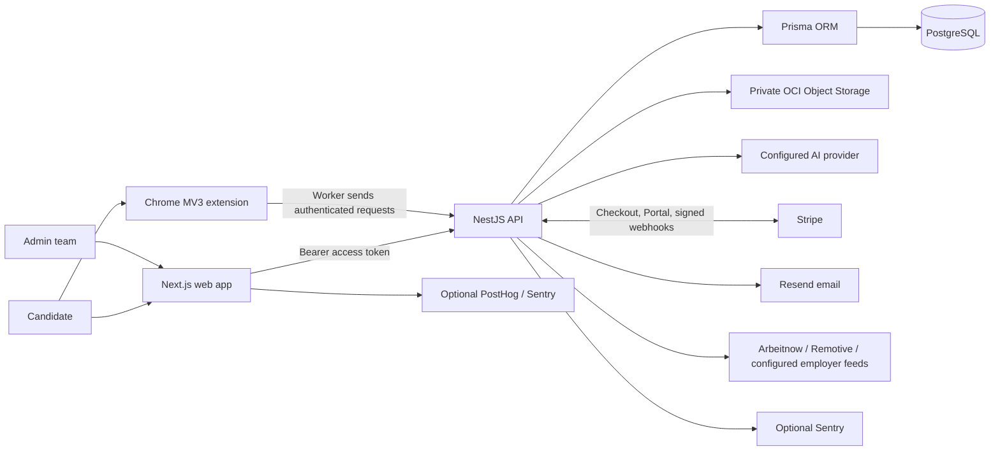

# JobIN System Architecture

**Implementation status:** Reviewed 13 November 2026. This document describes the current code in the active `apps/` workspaces. Historical proposals are not deployment evidence. See the [current project guide](./17_current_project_guide.md) for the complete product/API map.

## System context

## Components

### Web (`apps/web`)

Next.js 16 App Router and React 19. Public marketing/legal pages, account authentication, resume and job workflows, Stripe upgrade UI, and admin UI share the same web workspace. TanStack Query and API hooks provide data access; the browser receives public auth/client configuration only. `NEXT_PUBLIC_*` values are compiled into browser-visible code and must not contain credentials.

### API (`apps/api`)

NestJS 12, TypeScript, Prisma, PostgreSQL. The API owns token validation, user-to-identity linking, access checks, input validation, file access, AI-provider calls, billing webhooks, scheduled job feed synchronization, email, audit writes, and admin business operations. It uses the global `/api` prefix.

The source modules are organized around `users`, `dashboard`, `resumes`, `cover-letters`, `job-tracker`, `job-search`, `interview`, `billing`, `admin`, `ai`, `email`, `s3`, `oci-auth`, and `health`. `PrismaModule`, object storage, AI, export, and email are shared providers. The global scheduler runs feed synchronization; the global throttler enforces a baseline request limit.

### Extension (`apps/extension`)

Manifest V3 client composed of popup, options, side panel, service worker, and content scripts. The worker owns auth state and API requests. Content scripts extract job page details and communicate using extension runtime messages. The autofill content script handles Greenhouse and Lever application forms. Exact hosts and match patterns are in `apps/extension/manifest.config.ts`.

### Persistence and storage

- PostgreSQL is accessed through Prisma; `apps/api/prisma/schema.prisma` is canonical.
- Private resume objects are stored in OCI Object Storage; relational records carry ownership and object references.
- AI settings and usage, job-feed sync state, account data, billing, admin role assignments, and audit records are stored in PostgreSQL.
- The active application does not use the Pinecone, Elasticsearch, AWS RDS/S3, Redis/BullMQ, or Kubernetes tiers described by earlier proposals.

## Trust boundaries and request flow

1. Browser/extension authenticates through the configured identity provider.
2. Client sends a verified provider access token in the `Authorization` header to protected API routes.
3. `SupabaseAuthGuard` (historical name) validates supported provider tokens according to API configuration and resolves or creates the corresponding JobIN `User`.
4. User services use the resolved JobIN ID to scope user-owned records. Admin routes additionally load current role and permission assignments and check account status.
5. API performs database, object storage, third-party AI, email, or Stripe operations with server-side credentials.
6. API returns application data. Secrets, AI provider keys, and database access stay server-side.

Stripe webhook requests are handled with the raw request body and verified signature. Webhook events, not client redirects, update subscription and payment records. Job listings retain their original provider URL and attribution; provider data is fetched server-side and not through browser scraping.

## Authentication providers

- Web default is OCI Identity Domains Authorization Code + PKCE when `NEXT_PUBLIC_AUTH_PROVIDER=oci`; Auth0 can be selected. Supabase-based email/password and Google flows are also configured in the client.
- Extension can use OCI, Auth0, or Supabase according to its Vite build configuration and separate OAuth client registration.
- API supports `AUTH_PROVIDER=oci`, `oci_dual`, `auth0`, and Supabase validation modes. `oci_dual` is used during migration where both OCI and Supabase clients still need to call the API.
- Admin portal login uses a Supabase cookie-managed session. In an OCI deployment the API must accept this token, commonly by using `oci_dual`.
- ID tokens are for client identity/session purposes; protected API requests must use API access tokens.
- Provider identity maps to `User.supabaseId`, `auth0Sub`, or `ociSub`. Verified email can be used for account linking as implemented by the guard. Provider-specific verification remains external to JobIN's account status.

## Data ownership and multi-tenancy

User-owned resumes, cover letters, applications, subscriptions, AI usage, notifications, saved jobs, and support tickets include a user relation. Service queries are scoped to the authenticated user or authorized admin. Shared job catalogue records are intentionally not user-owned. `User.tenantId` exists for future/limited tenant use, but the product does not currently implement a full organization tenancy layer, automatic tenant query filters, or database row-level security.

## External integrations

| Integration | Purpose | Configuration location |
|---|---|---|
| OCI Identity Domains / Supabase / Auth0 | User identity, JWTs, account lifecycle | API provider vars and web/extension public OAuth settings |
| OCI Object Storage | Private resume file objects | API `OCI_*` settings; workload identity/config-file mode |
| Gemini, OpenAI, Anthropic, DeepSeek, Groq, Kimi, NVIDIA, Ollama | Resume/cover-letter/interview/support generation | Admin provider selection, encrypted provider credentials, stable encryption key |
| Stripe | Checkout, customer portal, recurring prices, discounts, refunds, webhooks | API `STRIPE_SECRET_KEY`, `STRIPE_WEBHOOK_SECRET`; configured prices |
| Resend | Admin campaign and support email | API `RESEND_*` |
| Arbeitnow, Remotive, Greenhouse, Lever, Ashby | Public job-search feeds | Built-in provider routes; optional company board slug settings |
| Sentry / PostHog | Optional error and product analytics | Private API DSN and public web analytics settings respectively |

There is no guaranteed completeness/freshness SLA for public job feed providers. Remotive is on-demand only because its API terms restrict catalogue republishing without permission. The website does not scrape LinkedIn or Indeed.

## Security controls

- Exact configured CORS origin allowlist; production origins must use HTTPS.
- Express proxy trust is opt-in and bounded through `TRUST_PROXY_HOPS`.
- Security headers are installed by the API. Swagger is disabled by default and cannot be enabled in production.
- Global DTO validation uses whitelist, transform, and rejection of unknown fields.
- Global API throttle is 60 requests per minute; support chat and admin notification routes have tighter limits.
- Generic 5xx response bodies avoid returning database/provider internals. Request logging avoids bodies and authorization tokens.
- Admin access requires active account plus admin role. Fine-grained role permissions are checked server-side; Super Admin-only operations are separately guarded.
- Privileged admin changes use audit records. Resume processing uses owner checks, private storage, bounded validation, safe temporary file handling, and untrusted TeX compilation settings.
- Secrets are private service environment values. Only intentionally public `NEXT_PUBLIC_*` and `VITE_*` values are exposed to clients.

These controls describe source-level implementation; they are not a claim of a complete external penetration test or zero remaining vulnerabilities.

## Deployment shape

The repository configures a Render API service in `render.yaml`; separate web deployment and OCI VM migration/cutover instructions are maintained in README and `deploy/oci/`. Production startup applies Prisma migrations before serving API requests. Verify which host is active before a deployment/cutover and keep required environment variables in that host's secret manager. The API health endpoints are `/api/health` and `/api/health/ready`.

## Not current architectural components

Older planning documents reference Clerk, AWS WAF/CloudFront, Route 53, AWS RDS/S3, Pinecone, Elasticsearch, Redis/BullMQ, Kubernetes, Datadog, and a general multi-tenant enterprise layer. Those references describe proposals or examples, not the active deployment/code in this repository. Do not provision these services based on the old design alone.
