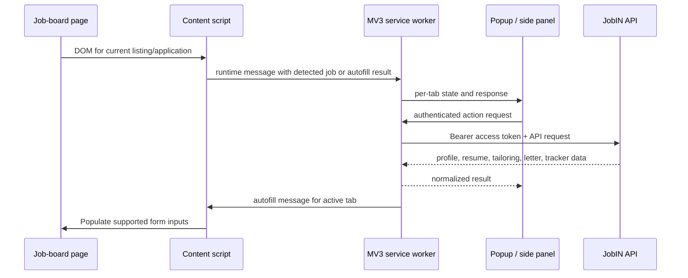

# JobIN Chrome Extension Architecture

**Reviewed:** 13 November 2026. The active implementation is `apps/extension`; the current manifest is generated from `apps/extension/manifest.config.ts`. This replaces the former proposal, which described selectors, hosts, Clerk encryption, and capabilities that were not aligned with the source.

## Product surfaces

The extension is a Chrome Manifest V3 app with:

- **Popup:** compact launcher/current-tab actions.
- **Side panel:** detected job details and JobIN actions.
- **Options page:** auth and extension preferences.
- **Background service worker:** authenticated API boundary, extension storage and message router.
- **Content scripts:** read supported job pages and fill supported application forms.

Source roots are `src/popup`, `src/sidepanel`, `src/options`, `src/background`, `src/content`, and `src/shared`.

## Process and message flow



The service worker imports API helpers from `src/shared/api.ts`; shared message names and storage helpers are under `src/shared`. The content script does not make API calls directly. The worker requests only the data needed for the user action and routes the payload to the appropriate tab.

## Supported pages

Manifest match patterns are the authoritative list. Current page detection patterns include LinkedIn jobs, Indeed, Reed jobs, Totaljobs, and Glassdoor. Host permissions also include Greenhouse boards, Lever jobs, Workday, and the API/auth origins. The current DOM extractor has selector maps for LinkedIn, Indeed, Reed, Totaljobs, Glassdoor, Greenhouse and Lever. A site can be host-permitted without having every feature implemented there.

The autofill scripts are specifically registered for Greenhouse and Lever. They use platform selectors and fallback label/placeholder scans. Autofill may require user review: field labels and provider forms change, and the extension does not guarantee that every field is recognized or that form submission is accepted.

Supported extension actions include listing the user's resumes, tailoring for a detected job, generating a cover letter, and saving the job/application through the API, subject to the signed-in account and service support.

## Authentication and storage

- Auth provider is selected at build time by `VITE_AUTH_PROVIDER`; the code supports configured Supabase, OCI, and Auth0 flows.
- Provider settings in `VITE_*` are public client configuration. Do not add provider secrets, database credentials, AI keys, or Stripe secrets to extension variables or bundle files.
- Auth state/settings use Chrome extension storage helpers. The worker attempts to restrict `chrome.storage.local` to `TRUSTED_CONTEXTS`. Do not describe this storage as encrypted; the extension code does not provide local cryptographic encryption of its token store.
- API access tokens are sent by the background worker to the configured API host. The API independently validates tokens and applies account/permission checks.
- Page content scripts use runtime messages to the worker. Treat page text, job descriptions, and form values as untrusted input.

## Permissions and privacy boundary

The manifest requests `activeTab`, `storage`, `sidePanel`, `scripting`, `declarativeNetRequest`, and `tabs`. Host permissions are explicit in `manifest.config.ts` and include targeted job sites plus configured API/auth origins. Content scripts should only read fields needed for job detection or autofill; the extension does not access site account passwords or submit a job application without the user's action.

The API may return resume metadata and performs resume tailoring server-side. Resume binaries remain in the API's private object storage; the extension should not copy resume contents into an unrelated page or third-party service. Review requested manifest permissions whenever an integration is added.

## Build and release

From the repository root:

```bash
npm ci
npm run build:extension
```

For development, copy `apps/extension/.env.example` to `.env.local`, set the local API URL and selected auth provider's public settings, and use the documented development OAuth client. Load the built extension output as an unpacked extension in Chrome. Before Web Store distribution, configure the exact `chrome.identity.getRedirectURL()` callback with the selected provider and set the public store URL in the web app.

The web application's extension page depends on `NEXT_PUBLIC_CHROME_EXTENSION_URL`; without it, the store button remains a coming-soon state.

## Known constraints

- This is a Chrome extension, not a Safari/Firefox extension or native mobile application.
- Page structure changes can break selectors; recheck supported hosts and selectors against current sites before claiming new coverage.
- Host permission means the extension may request the origin, not that API authorization is granted.
- There is no claim that the extension has passed Chrome Web Store review unless a publication status is separately confirmed.
