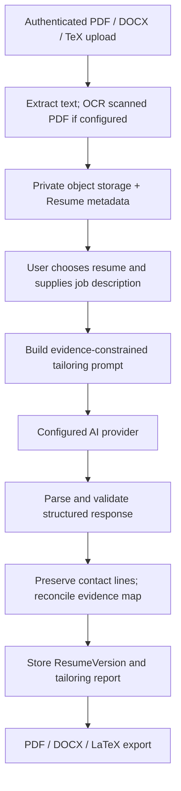

# JobIN AI Workflows

**Reviewed:** 13 November 2026. This document reflects the current API workflow in `apps/api/src/ai` and feature services. Earlier material describing GPT-4o/Claude defaults, Pinecone vectors, fixed cosine-match scores, or universal automatic fallback does not describe the current implementation.

## Provider routing

The API reads the active provider, model and optional base URL from `AIPlatformSettings`. Provider credentials are looked up server-side from `AIProviderCredential` and decrypted with `AI_SETTINGS_ENCRYPTION_KEY`. Gemini also reads its configured key from the API environment. Ollama can use a hosted reachable endpoint without a provider key. Supported provider adapters are Gemini, OpenAI, Anthropic, DeepSeek, Groq, Kimi/Moonshot, NVIDIA, and Ollama.

The active model/provider is configurable from the Super Admin AI Settings screen. The API normalizes provider-specific request/response formats, parses structured JSON where required, and records provider/model/token/cost estimates to `AIUsage`. The cost estimate is an operational estimate, not a vendor invoice. Provider-specific retry behavior is implemented in the adapter and is not a general multi-provider fallback guarantee.

**Operational rule:** Keep provider keys in API environment or encrypted API database records. Never add them to web `NEXT_PUBLIC_*` variables, extension `VITE_*` variables, source code, prompts shown to users, or logs. Keep `AI_SETTINGS_ENCRYPTION_KEY` stable: changing it makes stored provider credentials unreadable until they are re-entered.

## Resume upload, analysis, and tailoring

1. The authenticated upload route accepts PDF, DOCX, and `.tex` source up to the configured controller limit. PDF/DOCX text is extracted server-side. Text-based LaTeX is treated as source; uploaded commands are not executed. Low-text/image-heavy PDF can use Poppler plus Tesseract if installed/configured.
2. Original files are stored in private OCI Object Storage, with metadata and owner in `Resume`.
3. Tailoring combines extracted resume text and the user-provided job description. The prompt requires factual grounding: no invented employers, dates, credentials, skills, responsibilities, or metrics. The model returns complete resume text plus job requirement statuses, source evidence, evidence map, missing requirements, keyword counts, caveats, and estimated alignment values.
4. The API validates the structured result, preserves original contact lines, removes unsupported claims from the evidence map, and records a `ResumeVersion` with tailoring report and settings. AI usage is recorded separately.
5. The user can compare, edit and save a version and export PDF/DOCX/LaTeX using one of the supported single-column designs and page sizes.

The `scoreBefore`/`scoreAfter` values are model-generated role-alignment estimates. They are not calculated from a proprietary ATS engine, validated against a hiring platform, or a prediction of interview/hiring outcome. Users should check every generated statement for accuracy.

## Resume export

- PDF export compiles generated LaTeX with configured Tectonic when available, using untrusted-input settings and validating the output.
- If the compiler is unavailable or fails, a native PDFKit renderer provides the fallback; `X-PDF-Engine` identifies the selected engine.
- DOCX is generated on the API from the stored resume content and chosen design settings.
- LaTeX source can be downloaded for editing; it is not compiled on download.
- Temporary files for OCR and LaTeX processing are removed in the request cleanup path.

Production API image includes the export/OCR tools described in `apps/api/README.md`. Local installations can omit OCR/Tectonic; resulting behavior follows the configured fallback.

## Other AI-powered features

### Cover letters

The authenticated `/cover-letters/generate` workflow uses an owned resume when supplied, job description, company/role, hiring-manager name where provided, and selected letter variant. Generated letters are persisted in `CoverLetter`; export supports PDF and DOCX. The content is model output and requires user review.

### Interview practice

`POST /interview/question` generates a role/resume-aware question and records usage/credit impact. `POST /interview/evaluate` evaluates a submitted answer. The API does not store a first-class interview session model in the current schema.

### Public support chat

`POST /support/chat` is a rate-limited public endpoint for general JobIN product guidance. It is instructed to avoid account-specific facts and direct account issues to support. It must not be treated as authenticated account support.

## Usage and credits

`AIUsage` stores feature, provider model, prompt/completion/total token counts, estimated cost, tier, and credit units. Per-user `AICredits` stores totals/usage and optional expiry. Plan defaults and billing behavior are controlled by current service logic and database plan features. Admin reporting provides aggregate operational visibility; estimates depend on accurate model/provider configuration.

Do not assume that all generated content consumes the same number of credits, or that an estimated token cost exactly matches provider billing. Check the service implementation for the current feature's charge and refund-on-error behavior before changing credit policy.

## Data handling and prompt safety

- Resume text and job descriptions are personal/untrusted user content and are sent to the configured AI provider for the requested generation operation.
- Only the current provider/model receives a request; there is no Pinecone vector store, embedding database, or universal Claude→OpenAI→Gemini fallback in the active code.
- Prompt rules constrain generated claims, but do not guarantee factual correctness; the user remains responsible for final review.
- Support chat inputs are untrusted and constrained to general product support.
- Avoid logging full resumes, job descriptions, provider credentials, bearer tokens, or user answers. Do not put sensitive user content in analytics events.

## How to update this guide

When adding an AI feature, document its route, source service, prompt inputs, output validation, persistence, credit behavior, provider use, and error/retry semantics. Keep claims about quality/scoring bounded by actual evaluation evidence. Current controllers and implementations are the authority; test provider changes using controlled test credentials rather than production data.
