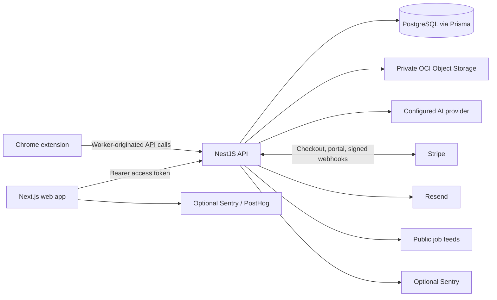

# JobIN Current Project Guide

**Reviewed:** 13 November 2026<br>
**Purpose:** Current, implementation-led guide to the JobIN repository. This describes code and configuration currently in this branch; it does not claim that third-party production integrations have been exercised. For code-level truth, use the source files and Prisma migrations linked below.

## What JobIN does

JobIN is a web product and Chrome extension for job seekers. It combines a public job catalogue and search, resume storage and job-specific tailoring, cover-letter and interview tools, application tracking, subscription billing, and an operations portal.

The main user journey is: create or sign into an account → set up a profile and add a resume → discover jobs or open a supported job board → tailor the resume for a role → save the opportunity and application progress → use AI career tools as needed. Users can download tailored resumes in PDF, DOCX, and LaTeX formats. Tailoring estimates role alignment; they are not a third-party ATS result or a hiring prediction.

## Repository map

| Path | Responsibility |
|---|---|
| `apps/web` | Next.js 16 App Router product, marketing pages, signed-in workspace, and admin portal. |
| `apps/api` | NestJS 12 REST API, auth validation, user-scoped workflows, scheduled feed refreshes, AI adapters, Stripe, email, and Prisma. |
| `apps/extension` | Chrome Manifest V3 popup, options, side panel, worker, job-page detection, and supported-ATS autofill. |
| `apps/api/prisma/schema.prisma` | Canonical current relational schema. |
| `apps/api/prisma/migrations` | Additive and historical database migrations; inspect these before applying to existing databases. |
| `docs/` | Product plans, architecture, API notes, runbooks, and audit records. See the documentation guide below. |
| `deploy/oci` | OCI VM deployment and staged cutover notes. |
| `render.yaml` | Render API deployment configuration. |

Legacy `backend/` and `frontend/` snapshots are not the active workspace applications. The current npm workspaces are declared in the root `package.json`.

## Runtime architecture



The API is the trusted boundary for database access, AI-provider credentials, file operations, billing, and admin operations. The web app and extension do not connect directly to PostgreSQL or call private AI provider credentials. PostgreSQL is the durable source of truth. OCI Object Storage is used for private resume files; object metadata and ownership are stored in PostgreSQL.

The current implementation does not depend on the Pinecone, Elasticsearch, AWS RDS, AWS S3, Redis, BullMQ, or Kubernetes components described in some early planning documents. Those are not part of the active application architecture unless a deployment-specific change adds them.

## Authentication and account authorization

- The web client selects an auth adapter from `NEXT_PUBLIC_AUTH_PROVIDER`. OCI Identity Domains is the configured default; Auth0 is optional. Supabase client configuration also supports the email/password, Google, and admin-login flows documented in the app.
- The extension supports configured OCI, Auth0, and Supabase auth adapters. Its background service worker owns API calls; page content scripts message the worker.
- The API validates provider tokens according to `AUTH_PROVIDER` (`oci`, `oci_dual`, `auth0`, or Supabase mode) and maps the verified identity to a JobIN `User`. Never send an ID token where an API access token is expected.
- User-facing data routes authenticate with `SupabaseAuthGuard` (the guard name is historical; it validates the configured supported providers). Services scope records to the authenticated JobIN user.
- Admin routes additionally use `AdminRoleGuard`. The account must be ACTIVE and have an admin role. Endpoint permissions are read from `RolePermission`; Super Admin bypasses permission checks. Role assignment, permanent user deletion, AI-provider settings, and editing role grants require Super Admin.
- The admin sign-in page uses the Supabase cookie session; ensure the API accepts the corresponding Supabase token when using it (for an OCI deployment this is typically `oci_dual`).
- Account status values are `ACTIVE`, `SUSPENDED`, and `DELETED`. There is no separate manual email-verification state in the current Prisma `User` model; identity providers enforce email verification where configured.

## Product capabilities

### Web app

- Public homepage, careers, about, contact, support, extension, privacy, and terms pages.
- Sign-in, sign-up, OAuth callback, password-recovery routes, and provider-specific authentication.
- Dashboard, profile/settings, job search, tracker, resume library/detail, resume tailoring, cover letters, interview practice, and Stripe upgrade flows.
- Responsive desktop and mobile layouts; the extension is a separate Chrome surface, not a mobile app.

### Job search and feeds

- Authenticated `GET /api/job-search` searches the shared database catalogue with query, location, remote-only, likely visa-sponsorship, source, age, sort, and pagination filters.
- Authenticated `POST /api/job-search` runs on-demand search and may import selected results into the user's tracker.
- Scheduled catalogue sources are Arbeitnow plus configured Greenhouse, Lever, and Ashby company boards. Initial sync begins at API startup; the scheduler checks due feeds every 30 minutes, with a six-hour successful refresh interval and retry state for failures. A per-feed lease avoids overlapping refreshes across API instances.
- Remotive is used for on-demand search only, not catalogue republishing. Feed availability is best-effort; public providers may rate-limit or be unavailable. The service keeps source labels and original listing URLs visible.
- These feeds are not a complete labour-market index. JobIN does not scrape LinkedIn or Indeed for the website catalogue.
- Configure company board slugs with `JOB_SEARCH_GREENHOUSE_BOARDS`, `JOB_SEARCH_LEVER_BOARDS`, and `JOB_SEARCH_ASHBY_BOARDS`; blank settings use provider defaults where defined. See [API deployment and feed notes](../apps/api/README.md#public-job-search-feeds).

### Resumes and AI

- Upload accepts PDF, DOCX, and LaTeX source in the resume tailoring flow. Text is extracted server-side; image-heavy PDFs may use Poppler/Tesseract OCR.
- AI tailoring returns structured resume text, job requirements, evidence mapping, missing requirements, keyword counts, and informational before/after role-alignment estimates. The service preserves original contact lines and validates that claims can be traced to source evidence.
- Versions store the generated content and report. Users can edit saved tailored versions and export PDF, DOCX, or LaTeX. PDF export uses Tectonic when available and falls back to native PDFKit rendering.
- AI providers are selected server-side from Gemini, OpenAI, Anthropic, DeepSeek, Groq, Kimi/Moonshot, NVIDIA, or hosted Ollama. Provider keys are stored encrypted in the database using `AI_SETTINGS_ENCRYPTION_KEY`; the key must remain stable to decrypt existing credentials.
- AI usage/cost estimates are recorded in `AIUsage`; plan credits are tracked separately. Provider pricing/usage estimates depend on configured models and are not billing statements.
- Cover-letter generation and interview practice use the same server-side provider configuration and persist the corresponding user content/usage records.

### Chrome extension

- Manifest V3 extension with popup, options page, side panel, background service worker, and page content scripts.
- Detects/extracts role details on supported job pages and provides profile/resume actions; the supported ATS autofill paths include Greenhouse and Lever. Exact host permissions and URL matches are in `apps/extension/manifest.config.ts`.
- The worker handles authenticated API requests, settings and limited session caches, detected job state, and content-script messaging. Content scripts read the page and fill supported form controls; they must not receive provider secrets.
- Build with `npm run build:extension`. Set Vite variables in `apps/extension/.env.local`; configure the extension OAuth redirect URL with the identity provider before distributing a published build.

### Billing and discounts

- Stripe is the customer payment processor. The API creates Checkout and customer-portal sessions; signed webhooks update subscription, invoice, failed-payment, and refund state.
- Admin-managed complimentary access is represented as a JobIN subscription, not a Stripe charge.
- Global percentage promotion codes are created in Stripe by finance admins. Checkout is the source of truth for redemption. A 100% discount can make the current invoice zero, but Checkout still collects a payment method when future renewals may be charged.
- Finance admins can view payment state and issue full/partial refunds through Stripe. Disputes remain managed in Stripe Dashboard.
- Commission reporting is not implemented; there is no commission model or ledger in the current schema.
- See [discount code behavior](./16_discount_code_rules.md).

### Admin portal

Admin pages live under `/admin` and the API routes under `/api/admin`.

| Area | Capability | Permission family |
|---|---|---|
| Dashboard | User, subscription, resume, application, and AI usage metrics. | `reports:dashboard` |
| Users | Search/list and inspect account activity; status, plan, and credit changes are service-checked; permanent delete and user role assignment are Super Admin actions. | `users:read`, `users:manage_status`, `users:manage_billing`; Super Admin for delete/role |
| Billing | Subscription and payment overview, failures/refunds, Stripe prices, discount-code management. | `billing:*`, `payments:refund`, `discounts:manage` |
| AI | Usage reports for finance/operations; provider configuration is Super Admin only. | `ai:read`; Super Admin for provider settings |
| Support | Read/assign/update tickets and send replies. | `support:read_tickets`, `support:write_tickets` |
| Notifications | Send email or in-app message to one user or an active/paid/churned audience. Rate limited and audited. | `notifications:send` |
| Site content | Create, schedule, update, and deactivate homepage banners. Active banners are publicly readable. | `content:manage` |
| Reports | Stream CSV exports for users, payments, subscriptions, and AI usage. CSV formula-leading values are neutralized. | `reports:users`, `reports:billing`, `reports:subscriptions`, `reports:ai` |
| Roles | Super Admin can update permission grants for operations, support, and finance roles. Changes are audited. Super Admin's own access is implicit and not editable. | Super Admin only |

Public support/contact forms currently submit through Web3Forms; they are not connected to the admin `SupportTicket` queue. The support/contact fallback email is `info@jobin.today`. User verification is currently represented by identity-provider verification and account status; there is no separate admin verify button/state. API email sending uses Resend configuration.

## Current REST endpoint map

All API routes use the `/api` prefix. JSON bodies are validated with a global whitelist/transform pipe that rejects unknown fields. Protected routes use `Authorization: Bearer <access-token>`.

| Route group | Endpoints (method + path, excluding `/api`) | Access |
|---|---|---|
| Health | `GET /health`, `GET /health/ready` | Public probe |
| OCI keys | `GET /auth/oci/jwks` | Public signing-key discovery/cache endpoint |
| Profile | `GET/PATCH/DELETE /users/me` | Signed-in user; delete is a soft delete |
| Dashboard | `GET /dashboard/summary` | Signed-in user |
| Resumes | `POST /resumes/upload`; `GET /resumes`; `GET/PATCH/DELETE /resumes/:id`; `POST /resumes/:id/analyse`; `POST /resumes/:id/tailor`; `GET /resumes/:id/versions`; `PATCH /resumes/:id/versions/:versionId`; `GET /resumes/:id/export/{pdf,docx,latex}` | Signed-in owner |
| Cover letters | `POST /cover-letters/generate`; `GET /cover-letters`; `GET/DELETE /cover-letters/:id`; `GET /cover-letters/:id/export/{pdf,docx}` | Signed-in owner |
| Applications | `GET /applications/stats`, `GET /applications/activity`, `POST /applications`, `GET /applications`, `GET/PATCH/DELETE /applications/:id` | Signed-in owner |
| Job search | `GET /job-search`, `POST /job-search` | Signed-in user |
| Interview coach | `POST /interview/question`, `POST /interview/evaluate` | Signed-in user |
| Billing | `GET /billing/checkout-options`; `GET /billing/usage`; `POST /billing/create-checkout-session`; `POST /billing/portal`; `POST /billing/webhook` | Options/webhook public; remaining calls signed-in; webhook signature verified |
| Support chat | `POST /support/chat` | Public; tighter endpoint throttle |
| Public content | `GET /content/banners` | Public; returns active banners in their schedule window |
| Admin | See `Admin API routes` below. | Signed-in active admin role plus endpoint permission, except documented Super Admin actions |

### Admin API routes

| Method + path | Required permission |
|---|---|
| `GET /admin/access` | Any active admin role (returns roles and assigned permission actions) |
| `GET /admin/metrics` | `reports:dashboard` |
| `GET /admin/users`, `GET /admin/users/:id/activity` | `users:read` |
| `PATCH /admin/users/:id` | `users:read` route access; status and billing changes checked separately in the service; role assignment is Super Admin only |
| `DELETE /admin/users/:id` | Super Admin |
| `GET /admin/subscriptions`, `GET /admin/billing`, `GET /admin/stripe-prices` | `billing:read` |
| `POST /admin/stripe-prices` | `billing:write` |
| `GET/POST /admin/discount-codes`, `PATCH /admin/discount-codes/:id/deactivate` | `discounts:manage` |
| `POST /admin/payments/:id/refund` | `payments:refund` |
| `GET /admin/ai-usage` | `ai:read` |
| `GET/POST /admin/ai-settings` | Super Admin |
| `GET /admin/tickets` | `support:read_tickets` |
| `PATCH /admin/tickets/:id`, `POST /admin/tickets/:id/reply` | `support:write_tickets` |
| `POST /admin/notifications/send` | `notifications:send`; 2 requests/minute per rate-limit identity |
| `GET/POST /admin/content/banners`, `PATCH/DELETE /admin/content/banners/:id` | `content:manage` |
| `GET /admin/reports/users.csv` | `reports:users` |
| `GET /admin/reports/billing.csv` | `reports:billing` |
| `GET /admin/reports/subscriptions.csv` | `reports:subscriptions` |
| `GET /admin/reports/ai-usage.csv` | `reports:ai` |
| `GET /admin/roles`, `PATCH /admin/roles/:id/permissions` | Super Admin |

The general API throttle is 60 requests per minute. The default throttler storage is in process, so limits are per API instance unless a shared store is added. Swagger is disabled by default and only starts outside production when `ENABLE_SWAGGER=true`.

## Data model at a glance

`apps/api/prisma/schema.prisma` is authoritative. Important model groups:

- **Identity and access:** `User`, `Role`, `Permission`, `UserRole`, `RolePermission`, `AuditLog`.
- **Plans and payments:** `Plan`, `PlanFeature`, `StripePriceConfig`, `Subscription`, `Payment`, `Invoice`, `AICredits`.
- **Resume/AI:** `Resume`, `ResumeVersion`, `AIUsage`, `CoverLetter`, `AIPlatformSettings`, `AIProviderCredential`.
- **Applications and jobs:** `Company`, `JobApplication`, `SavedJob`, shared `JobListing`, `JobFeedSyncState`.
- **Communication/content:** `SupportTicket`, `TicketResponse`, `Notification`, `SiteBanner`.

Ownership foreign keys cascade for user-owned resume, application, saved-job, subscription, AI usage, notification, and ticket records as defined in Prisma. Shared job listings are not user-owned. Currency and amount values in payment records are floats in the current schema; an integer-minor-unit migration has not been done. `tenantId` exists on `User`, but current operations are primarily user-scoped and do not provide a complete organization tenancy/row-level security system.

The active schema does not define a separate discount code ledger; Stripe stores promotion codes. It does not define commission, manual email verification, announcement targeting, or a user-facing notification inbox workflow beyond stored notification records.

## Security and operational controls

- Production API CORS entries must be exact HTTPS origins; wildcard and malformed origins are rejected.
- Express trusts forwarded proxy headers only for a bounded `TRUST_PROXY_HOPS` count; keep it correct for the deployment topology.
- Security headers are enabled. Swagger cannot be enabled in production.
- Global DTO validation transforms input, strips no unknown fields silently, and rejects unrecognized properties. Endpoint-specific throttles supplement the global limit.
- API error responses hide internal details for server errors; logs avoid request body/token dumps and use bounded/sanitized messages.
- Exception: the public readiness probe currently includes the caught database error message in its `503` response body; treat this as diagnostic output and review before exposing the probe to untrusted clients.
- Secrets belong only in private service environments. Only intentionally public `NEXT_PUBLIC_*`/`VITE_*` values may ship in browser/extension builds. `.env*` files are ignored except example templates.
- Resume files use private object storage and short-lived owner-checked downloads. TeX processing treats upload data as text and uses untrusted-input compiler mode where configured. Temporary processing files are cleaned up.
- Extension storage is restricted to trusted contexts; page content scripts communicate with the worker rather than holding API credentials or provider keys.
- Admin mutations, refunds, notification sends, role-permission changes, and CSV exports use the audit log where implemented.
- This describes implemented controls, not a claim of a complete independent penetration test or zero vulnerabilities.

## Known implementation boundaries

- Public job feed availability is provider-dependent and may be delayed/rate-limited; the catalogue is not a complete market inventory.
- Public support/contact submissions are not persisted in admin tickets; a full user notification inbox is not implemented.
- Identity-provider verification is authoritative; there is no manual JobIN verification flag. The account status supports active, suspended and deleted states only.
- Commission tracking, full enterprise organization administration, and tenant-level row security do not exist in the current schema.
- The 1 Nov browser audit found `/forgot-password` and `/reset-password` redirected to `/sign-in` in the Supabase unauthenticated flow because those paths were not allowlisted in the proxy. This guide's review was source-focused; do not assume that report was resolved without a provider-specific browser check.
- No web Playwright/E2E suite is configured. API tests are focused unit/service/guard tests; live OAuth, email, AI provider, object storage, Stripe, and browser extension flows need integration verification.

## Environment configuration

Copy the examples and fill in local values; never copy actual secret values into docs or commits.

| App | Example file | Notable settings |
|---|---|---|
| API | `apps/api/.env.example` → `.env` | `DATABASE_URL`, `DIRECT_URL`, `AUTH_PROVIDER`, provider auth settings, `CORS_ORIGIN`, `TRUST_PROXY_HOPS`, `STRIPE_*`, AI keys/encryption key, OCI storage, `RESEND_*`, `NEXT_PUBLIC_URL`, job board slugs, optional `SENTRY_DSN`. `REDIS_URL` remains in the example but the current API modules do not use Redis. |
| Web | `apps/web/.env.example` → `.env.local` | `NEXT_PUBLIC_API_URL`, `NEXT_PUBLIC_AUTH_PROVIDER`, public auth-client metadata, public analytics IDs, app URL, optional Web3Forms and Chrome Store URL. Never put private keys in `NEXT_PUBLIC_*`. |
| Extension | `apps/extension/.env.example` → `.env.local` | `VITE_API_URL`, `VITE_AUTH_PROVIDER`, and the selected auth provider's public client settings. Do not place server credentials in Vite variables. |

See each example file for the current complete variable set and comments. Environment requirements depend on which auth provider and integrations are enabled.

## Local development

Prerequisites: Node.js 20.19+ (or 22.12+), npm, PostgreSQL, and credentials for the integrations you want to exercise. OCR/PDF export may need Poppler/Tesseract and Tectonic; PDFKit is the PDF export fallback.

```bash
# repository root
npm ci
cp apps/api/.env.example apps/api/.env
cp apps/web/.env.example apps/web/.env.local
# edit local environment files before starting
npm run db:generate --workspace=apps/api
npm run db:migrate:deploy --workspace=apps/api
npm run dev:api
```

In a second terminal:

```bash
npm run dev:web
```

The web app is at `http://localhost:3000`; the API base is `http://localhost:4000/api`. Build the extension with `npm run build:extension`; load `apps/extension/dist` in Chrome's extension developer mode. Do not run migrations against a production database from a local environment. For an existing database without migration history, reconcile the baseline before `migrate deploy`; do not replay the initial schema.

Common checks:

```bash
npm run build
npm run build:extension
npm test --workspace=apps/api -- <spec-file-or-pattern>
npm run lint
```

The web workspace has a production build but no dedicated browser E2E suite is currently configured. Tests cover selected API services/guards; live OAuth, Stripe, feed-provider behavior, OCR dependencies, and production storage require integration credentials and runtime checks.

## Deployment and migrations

- The current API deployment configuration is `render.yaml`; the OCI deployment/cutover guides are in `deploy/oci/`. The web app is deployed separately (documented Vercel setup). Verify the current environment/host before deploying; keep rollback strategy for infrastructure cutovers.
- API production startup runs Prisma `migrate deploy`. Review and back up before production schema changes, especially any destructive migration.
- Admin feature migrations added in November 2026: `20261113_admin_payment_management`, `20261113_admin_role_permissions`, and `20261113_admin_site_banners`. The database must apply them before using dependent endpoints. Apply through the controlled deploy/start path; this guide does not apply them.
- Resume tailoring support added migration `20261112_resume_tailoring_report`; job catalogue models are in `20261109_job_listing_catalog`; identity-provider migrations are documented in README deployment sections.
- Set all server-only keys in the API deployment secret store; set web public client settings in the web deployment. Use exact production CORS origins and configure Stripe webhook event delivery to the API.

## Documentation map and maintenance

| Document | Use |
|---|---|
| [README](../README.md) | Entry point, setup, deployment/auth provider runbooks. |
| [System architecture](./02_system_architecture.md) | Current component boundaries and integration flows. |
| [Database guide](./03_database_schema.md) | Current Prisma model catalog and data ownership. |
| [API reference](./04_api_specifications.md) | Current controller routes and access rules. |
| [Extension architecture](./06_chrome_extension_architecture.md) | Manifest, process model, host access, content extraction/autofill. |
| [AI workflow](./07_ai_workflow_design.md) | Actual providers, tailoring evidence, exports, usage limits. |
| [Discount code rules](./16_discount_code_rules.md) | Stripe promotion behavior and validation. |
| [API README](../apps/api/README.md) | Resume processing, public feeds, migrations, deployment-specific setup. |
| `docs/audit/*` | Dated inspection records. Treat findings as time-bounded and distinguish source review from live runtime verification. |
| `docs/01_*` through `docs/15_*` | Product requirements, user journeys, commercial analysis, and roadmap proposals. These are planning records, not necessarily committed feature promises. |

When behavior changes, update the relevant current guide, README links/setup, and the dated audit that the change invalidates. Prefer controller/schema/manifest source for exact route, model, and permission names. Record untested external integration behavior as unverified rather than calling it live/working.
